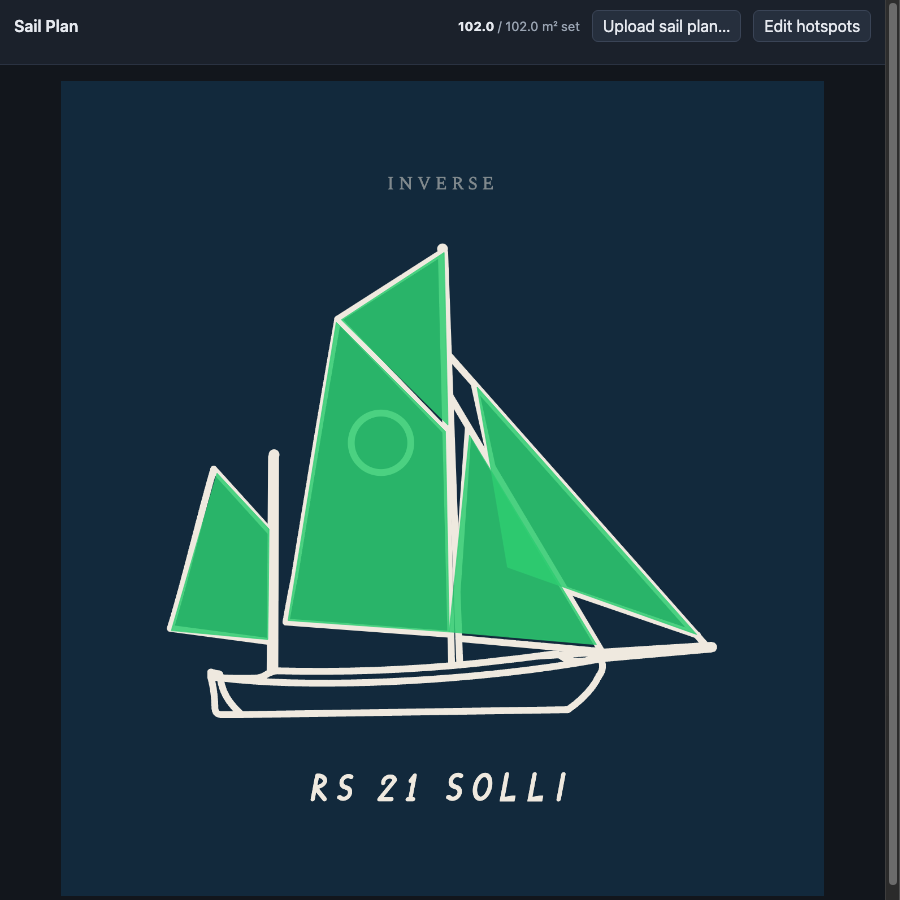

# signalk-sailplan-ui

Upload a sail plan diagram, trace a clickable hotspot over each sail (and each reef state), and tap a hotspot to tell Signal K which sails are currently set — no menus, no forms while you're on the helm.



*A gaff ketch (jib, foresail, mainsail, topsail, mizzen) with every sail set — the header reads the live computed area from `sailsconfiguration`. This is the sail plan diagram you'd upload:*


## How it fits together

This plugin only owns two things: the uploaded image, and the geometry of the hotspots drawn over it. It does **not** track sail state itself — that's the job of [`@signalk/sailsconfiguration`](https://github.com/SignalK/sailsconfiguration), which must also be installed. Clicking a hotspot here PUTs directly to that plugin's REST API, and the sail's real-time active/reef state comes back from its Signal K paths (`sails.inventory.*`, `sails.area.*`).

```
you click a hotspot  →  PUT /plugins/sailsconfiguration/sails/:id/active
                          PUT /plugins/sailsconfiguration/sails/:id/reducedState
                     ←  sails.inventory.<id> (active, reducedState) via Signal K deltas
                     ←  sails.area.total / sails.area.active (computed sail area currently set)
```

## Features

- Upload a sail plan as PNG, JPG, or SVG
- Trace a polygon hotspot for each sail, and for each reef point on that sail (e.g. "Main – full", "Main – reef 1", "Main – reef 2")
- Hotspots pull the sail list live from `sailsconfiguration`'s configured inventory — any number of sails, any names
- Click a hotspot to set that sail active at that reef level; click it again to stow it
- Active/reefed hotspots fill solid so each sail clearly reads as a pressed button, with a hover state on every hotspot
- Live header readout of total sail area currently set vs. total inventory area (from `sailsconfiguration`'s own calculation)
- Polls sail state on an interval so the display stays in sync with changes made elsewhere (e.g. NMEA input, another app)

## Install

Both plugins need to be enabled in Signal K's Plugin Config screen after installing:

```bash
cd ~/.signalk
npm install @signalk/sailsconfiguration signalk-sailplan-ui
```

Or install both from the Signal K App Store (search "Sails Configuration" and "Sail Plan UI"), then restart the server.

1. Enable **Sails Configuration** and define your sail inventory (id, name, type, area, reef areas).
2. Enable **Sail Plan UI**.
3. Open the "Sail Plan" webapp from the Signal K webapps list.

## Using it

**Upload sail plan…** — pick a PNG/JPG/SVG diagram of your boat's sail plan.

**Edit hotspots** — click points on the image to trace a sail's outline (minimum 3), pick which sail it represents and its reef level (0 = full sail), give it a label, and press "Add hotspot". Repeat for every sail, and for every reef state you want to be able to select directly (each reef level is its own traced shape, since that's usually how a sail plan diagram draws them). Press "Save hotspots" when done.

Leaving edit mode returns to the normal view: click a hotspot to set that sail/reef state, click it again to stow the sail.

## Embedding in another page

Open the app with `?embed=1` to show only the clickable diagram and the area readout. The title, upload, hotspot editing and side panel are hidden, so a host page such as a logbook can put it in a modal:

```html
<iframe src="/signalk-sailplan-ui/?embed=1" style="width:100%;height:480px;border:0"></iframe>
```

The page tells its host what happens with `window.postMessage`. Every message has `source: 'signalk-sailplan-ui'` and `version: 1`:

| `type` | When | Other fields |
|---|---|---|
| `ready` | after the first load | `ok` (the plan was fetched), `hasPlan` (an image has been uploaded), `hotspots` (how many) |
| `sail-changed` | after the user sets, reefs or stows a sail and the change went through | `sail: { id, name, active, reefs }`, the state after the change |

`sail-changed` is only sent for a change made in the embedded page, not for one made elsewhere.

Messages go to the app's own origin, so a host on the same server needs nothing more. A host on another origin names itself with `?embed=1&origin=https://host.example`. They are never sent to `*`. The host should check `event.origin` and `event.data.source`:

```js
window.addEventListener('message', (event) => {
  if (event.origin !== location.origin || !event.data || event.data.source !== 'signalk-sailplan-ui') return;
  if (event.data.type === 'ready' && !event.data.hasPlan) { /* fall back to your own editor */ }
  if (event.data.type === 'sail-changed') { /* close the modal, refresh */ }
});
```

Setting a sail needs the same access as in the full app (see below), and embedding changes nothing about that. A failed call is shown in the embedded page. Signal K does not block framing this page (checked on 2.33); a proxy in front of it might.

## Chartplotter extension (Freeboard-SK)

With the plugin enabled, a chartplotter that supports the [Plotter Extensions API](https://github.com/SignalK/freeboard-sk/blob/master/docs/api/plotter-extensions-api.md) gets two things, with nothing to install on the plotter:

- A **Sail Plan** button in the toolbar. It opens the clickable sail plan as a floating window (or a panel on a host without windows), the same page as `?embed=1`, so you can set sails without leaving the chart.
- A **Sails set** widget (2×1): the area set against the total, and which sails are flying with their reef, for example `48 / 56 m² set` and `Main R1 · Jib`. Tapping it opens the same window. It refreshes every few seconds.

In Freeboard-SK, tap the grid icon in the top-right corner to show the toolbar, then the sail button. To place the widget, press and hold an empty cell in a widget area for about a second and a half (or right-click it and choose **Add widget here**), then pick **Sails set**. Widgets stack from the screen edge inward, so in a bottom area use the bottom row.

Tested with Freeboard-SK 3.3.0 on Signal K 2.33. The extension is offered through the server's resources API, so the server must have one (Signal K 2.x); without it the plugin simply starts without the extension. Turning the plugin off removes it from the plotter. The window and the widget read the open Signal K API; setting a sail needs the same access as in the full app (see below).

## Access levels and MFD tiles

Signal K 2.x treats every `/plugins/<id>/...` route as admin-only unless the plugin opens it with `router.access(level)`. A device token, such as the one [signalk-navico-embedder](https://github.com/lukeescude/signalk-navico-embedder) injects for an MFD, is `readwrite` or `readonly`, never admin. So the routes a display needs are opened, and configuration stays admin-only:

| Route | Method | Access | Needed on an MFD |
|---|---|---|---|
| `/signalk/v1/api/signalk-sailplan-ui/state` and `/image` | GET | as the Signal K data API (`allow_readonly` or any token) | yes, the webapp reads from here |
| `/plugins/signalk-sailplan-ui/state` and `/image` | GET | `readonly` | same data, for clients that use `/plugins/` |
| `/plugins/signalk-sailplan-ui/image` and `/hotspots` | PUT | admin | no, set up from a normal browser |
| `/signalk/v1/api/vessels/self/sails/inventory` and `/area` | GET | as the Signal K data API | yes (published by `sailsconfiguration`) |
| `/plugins/sailsconfiguration/sails/:id/active` and `/reducedState` | PUT | whatever `sailsconfiguration` sets | only to set sails from the MFD |

On servers without `router.access` the plugin registers plain routes instead; the `/signalk/v1/api/...` read path works there too.

### Setting sails from an MFD

Reading works with any token. Setting a sail calls `sailsconfiguration`, which is a different plugin. From version 1.2.1 it opens `GET /sails` to `readonly` users and the `PUT /sails/...` routes to `readwrite` users, so a `readwrite` token (such as the one an MFD proxy injects) can set sails. In 1.1.0 and earlier those routes are admin-only, so a `readwrite` token gets `401`, and tap-to-set only works with an admin login; the page says so instead of failing silently.

The proxy must also forward that plugin's path. signalk-navico-embedder 1.8.0 forwards `/signalk`, `/skServer/loginStatus`, and for every enabled app both its path and `/plugins/<app path>`. That covers this plugin (id and webapp path are both `signalk-sailplan-ui`) but not `sailsconfiguration`, whose id differs from its webapp path `/@signalk/sailsconfiguration`. In an embedder build that has an `extraPluginPaths` option, add the plugin id `sailsconfiguration`; 1.8.0 as published has no such option, and without it the proxy answers `403` for those requests.

### What the page tells you when something fails

Every failed call is shown in the header with its method, path and status, instead of a generic error or an empty page:

- **401** is Signal K refusing the request. It answers 401 both for "no valid login" and "access level too low", so the page also asks `/skServer/loginStatus` and says who you are logged in as.
- **403** is not from Signal K. It means a proxy in front of it blocked the path, or the client's IP.
- **404 on a read** means nothing is published there, and is shown as "No data", not as an error.

Unauthenticated reads (no token) need `allow_readonly` in Signal K's security settings, or security off. A `readonly` or higher token works either way.

## Configuration

| Setting | Default | Description |
|---|---|---|
| `sailsConfigPluginId` | `sailsconfiguration` | Plugin id of the installed sail state provider, in case you run a fork or a renamed install of `@signalk/sailsconfiguration`. |
| `pollInterval` | `4` | Seconds between re-reading sail state to refresh the highlighted hotspots. |

## Development

```sh
npm test
```

Runs offline unit tests (Node's built-in `node:test`, Node 18+) against a mock Signal K app and router — no running server needed.

## License

ISC
